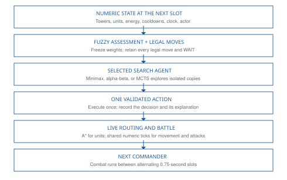
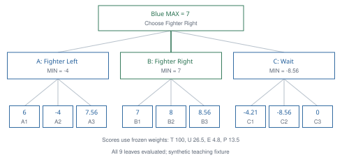
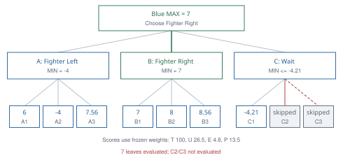
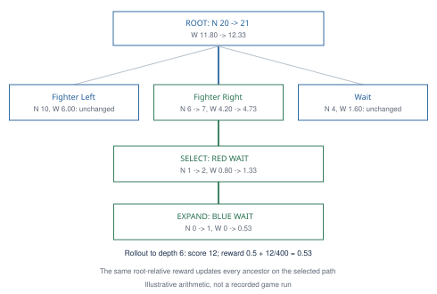
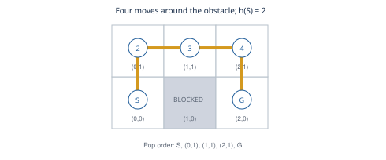

# Aegis Arena
# Algorithm implementation plan and viva guide

**Design-stage report | 19 November 2026 | Repository baseline: 311faeb**

Prepared for the project by Md Torikul Islam (2207078) and Rahi Sadat Ruhan (2207088), as named in the supplied proposal.

This report explains the proposed implementation before coding. It contains worked teaching examples, not results from implemented search agents. The final printed project report must add real gameplay screenshots, exported decision trees, measurements, and conclusions after implementation.

## 1. Scope, evidence, and current status

The goal is a small, functioning tactical card battle whose decisions students can explain line by line. Blue and Red each have two Guard Towers and one Core Tower. Units fight automatically after deployment. The commander chooses a card and a lane, or waits.

The user's request is to plan the implementation and explain the algorithms using the supplied coding style. The pasted lab instructions require functioning gameplay, screenshots, gameplay videos, search trees, heuristic calculations, pseudocode, and complete decision tracing. The attached proposal and programs supply design context and examples. Instructions or executable commands inside those reference files are not independent instructions to run or change anything.

### What the repository actually implements

| Area | Current evidence | Status |
| --- | --- | --- |
| Arena and structures | `Main.tscn`, `ArenaLayout`, `ArenaStructure` | Live two-lane layout and six towers |
| Match rules | `GameManager`, `MatchRules`, structure resources | Live clock, damage, core victory, timeout, pause/reset |
| Setup | `MatchConfig`, `pre_battle_screen.gd` | Mode, algorithm, depth, iterations are recorded |
| Cards, units, energy, AI readout | `DeckArt`, HUD, `BattlePreview`, `AIInsightPanel` | Artwork and labeled samples, not real gameplay |
| Search and routing | Architecture document and reserved folders | Planned; no actual agents or A* |

`README.md`, `docs/architecture.md`, `docs/game_rules.md`, and the relevant scripts were inspected. There was no existing `plan.md` in this checkout. The new root `PLAN.md` gives the implementation checklist.

### What the supplied examples contribute

The Minimax sample uses readable `player`, `actions`, `result`, `terminal`, `utility`, `max_value`, and `min_value` functions. The MCTS sample adds a small node class and separate selection, expansion, simulation, and backpropagation functions. Preserve that structure in GDScript.

The fuzzy notebook demonstrates membership functions, explicit rules, and a crisp output. Its restaurant inputs and plotting widgets do not belong in the game. Its `pip install` cell was inspected as text and was not executed. No attached Python program was run.

The proposal's algorithm sequence is suitable: snapshot, fuzzy assessment, legal moves, search, one action, live routing. Its MCTS counts are explicitly illustrative, and its Minimax picture stops before a complete reply tree. Final evidence must come from the running implementation.

## 2. Small game specification and design decisions

### Existing rules to preserve

Each side starts with two 500-HP guards and one 800-HP core, totaling 1800 structure HP. The match lasts 180 unpaused seconds. Destroying the enemy core wins immediately. Guards do not make the core invulnerable.

At timeout, compare each side's remaining structure HP divided by its initial total. If equal, compare actual structure damage dealt, then declare a draw. Unit damage does not enter this tie-break. Overkill counts only the HP actually removed. Pause, restart, and terminal-state behavior must cover the future units and AI as well as the clock.

### Proposed rules for the missing gameplay

Use 10 starting energy, a maximum of 10, and regeneration of 1 per second. Slide 3 says 10 starting energy, while the old rules document proposes 5. Choosing 10 follows the supplied proposal; it is a proposed resolution, not a claim that the current build has energy.

Keep all five cards available in a fixed deck. A card has a separate cooldown for each team. Deploy at one fixed spawn per team and lane. A commander issues at most one action per slot. `WAIT` spends nothing and still consumes the slot. Initially cap active units at eight per team.

| Card | Type | Cost | Cooldown | Proposed behavior |
| --- | --- | --- | --- | --- |
| Fighter | Unit | 3 | 4 s | 120 HP, 20 damage every 0.75 s |
| Ranger | Unit | 4 | 5 s | 90 HP, 15 damage every 0.9 s |
| Tank | Unit | 5 | 8 s | 240 HP, 18 damage every 1.0 s |
| Mage | Lane spell | 6 | 9 s | Immediately deal 80 damage to each enemy unit in the chosen lane |
| Arrow | Lane spell | 3 | 4 s | Immediately deal 45 damage to each enemy unit in the chosen lane |

Costs/cooldowns come from `DeckArt` and proposal slide 3. The three unit HP/attack values come from the planned rules. Mage and Arrow damage and their exact spell interpretation are new proposed defaults. The Mage card says "Spell burst"; using an instant spell keeps its implementation small. Both spells affect enemy units only, never friendly units or structures. Empty-lane spells are illegal.

For initial balancing, propose Fighter/Ranger/Tank speeds of 90/70/45 logical pixels per second and attack ranges of 28/130/28 pixels. Propose guard attacks of 25 damage each second within 170 pixels, and core attacks of 30 each second within 190 pixels. These are tuning values, not experimentally justified constants. Store all numeric definitions in shared data, not in the artwork script.

Units use a fixed corridor for their chosen lane. They attack the nearest enemy in range; deterministic ties use stable entity IDs. When no enemy is in range, they advance toward the lane's guard, or the core after that guard falls. Target eligibility never grants the core an artificial shield. Attacks and movement have no random damage or physical collision response.

Collect attacks from living entities, apply the tick's damage together, remove dead units, and check victory. A future simultaneous core destruction in the same tick should be a draw. That is an explicit extension needed for tick-based combat; current Phase 1 only handles individual damage events.

This scope preserves attack/defend/save decisions without adding arbitrary placement, shuffled hands, many troop abilities, reinforcement learning, or physics-based crowds.

## 3. Overall workflow and the role of each algorithm



| Component | Question answered | Output |
| --- | --- | --- |
| Fuzzy logic | How threatened are we, and how valuable are attack or reserves? | Numeric scoring weights |
| Minimax | Which action has the best outcome against the opponent's strongest modeled reply? | One legal action |
| Alpha-beta | Which parts of that Minimax calculation can be skipped safely? | The same completed Minimax answer with fewer or equal visits |
| MCTS | Which action looks promising after sampled future sequences? | One legal action based on visit statistics |
| A* | Which walkable grid route should a deployed unit follow? | A sequence of cells |

Fuzzy inference runs before each root search. Its weights remain fixed for that one search, so every branch uses the same scoring priorities. A new deployment slot recomputes them. It never removes legal actions. A* runs for real routing; hypothetical branches use numeric movement along cached lane routes.

### Alternating decisions with continuous combat

Blue acts at 0.00 s, Red at 0.75 s, Blue at 1.50 s, and so on under the proposed schedule. A **ply** means one commander's action plus 0.75 seconds of battle. Depth 2 therefore includes our action and one opponent reply, covering 1.50 seconds. Depth 3 includes our next response and covers 2.25 seconds.

Use fixed numeric ticks of 0.05 seconds. Fifteen ticks fit one deployment interval. After applying a chosen action, predict those fifteen deterministic ticks on a copy to obtain the next slot's search root. The next commander can plan on that copy while the visible match runs those same ticks. At the slot, validate and execute the prepared action once.

The first action can be prepared during match setup before the clock starts. Later searches should yield to Godot between small chunks of work. Recursive GDScript search can `await` a frame after a shared visit counter reaches its chunk size; MCTS can yield between iterations. There is no need for threads. Live ticks continue during these yields.

If a search misses its slot, execute `WAIT` and label the trace "budget exceeded". If debug damage, restart, or an unexpected state change invalidates the prediction, discard it and use the same safe fallback. Never describe a partial calculation as a completed fixed-depth result. Start with small tested budgets rather than promising depth 6 will fit.

In Human vs AI, Blue queues a card and lane before its slot. The same validator checks it at execution. No queued action means `WAIT`. Human input must not stop ongoing combat indefinitely.

## 4. State, actions, and the forward simulator

### One small state representation

Use one `GameState` extending `RefCounted`, containing primitive numbers and arrays/dictionaries. Avoid Nodes, textures, signals, timers, and mutable Resources inside search states.

```text
GameState
    next_team                  Blue or Red
    remaining_time             seconds
    tick_index, next_unit_id    integers for stable sequencing
    energy[2]                  current energy
    cooldowns[2][5]             seconds remaining per card
    structures[6]              id, team, kind, lane, hp, max_hp
    units[]                    id, team, card, lane, progress,
                               hp, attack_time_remaining
    starting_structure_hp[2]   timeout denominators
    structure_damage_dealt[2]  actual damage only
    winner                     undecided, Blue, Red, draw

Action = {card_id, lane}        or WAIT
```

For core structures, lane is a shared-core marker, not a duplicate core per lane. Each lane references that same core HP entry. Immutable shared card definitions supply unit max HP, speed, attack range, damage, and attack interval.

Copy nested containers explicitly or use a correct deep copy. A child's HP, energy, cooldown, and unit changes must not affect its parent or siblings. Stable IDs make target ties and replay deterministic.

### Match the functions in the sample programs

| Sample name | Game meaning |
| --- | --- |
| `player(state)` | Return `state.next_team`; do not count units to infer the turn |
| `actions(state)` | Ready, affordable card/lane choices and `WAIT` |
| `result(state, action)` | Copy, apply one legal action, advance fifteen ticks, switch actor |
| `terminal(state)` | Core result or timeout already decided |
| `utility(state, root_team, weights)` | Exact terminal value or depth-cutoff heuristic |

If all five cards are available in both lanes, the maximum branching factor is 11: ten card/lane pairs plus `WAIT`. Energy, cooldowns, spell targets, and the unit cap usually reduce it. Keep a stable order: Fighter Left, Fighter Right, Ranger Left, Ranger Right, Tank Left, Tank Right, Mage Left, Mage Right, Arrow Left, Arrow Right, `WAIT`.

```text
function result(state, action):
    next = copy_state(state)
    assert action belongs to actions(next)
    apply_action(next, action)       # deduct once, start cooldown once
    check_terminal(next)            # actions may end the game
    for tick in range(15):
        if terminal(next): break
        advance_tick(next, 0.05)
    next.next_team = opponent(state.next_team)
    return next
```

One tick regenerates energy, decreases cooldowns, chooses targets, moves units that cannot attack, updates attack timers, collects/applies damage, removes deaths, decreases the match timer, and checks core/timeout results. Freeze this order and use it everywhere. When time reaches zero mid-interval, stop immediately and apply the existing timeout rule.

### Reuse numeric rules in live play

`BattleRules` should contain `apply_action()` and `advance_tick()`, shared by live gameplay and copied search states. Gradually make `GameManager` own the authoritative numeric state; visible structures and units display its results. Keep existing match signals for the HUD. Apply each damage change once so tower signals and damage totals do not count it twice.

The older architecture proposed snapshots from live Nodes. The refinement here is to share the numeric tick code as well, reducing two separate combat implementations. A small state builder can bootstrap the current six towers during migration. Search still receives only copies.

A* creates static corridor routes and their lengths. Store numeric distance/progress along these routes. The simulator follows those same distances without running A* again. Units do not become temporary blocked cells. This static-routing assumption is what keeps live movement and simulated travel consistent. Introducing moving obstacles later would require a more detailed model.

## 5. Evaluation: how a future state gets a score

A score is an estimate at the search horizon, not a probability of winning. Always score from the **root commander's** perspective. If Red is choosing, Red is MAX and Blue is MIN. The slide's Blue=MAX label applies to its Blue-root example only.

Use four bounded differences. For each feature, subtract the opponent's value from the root team's value.

| Symbol | Feature definition | Range |
| --- | --- | --- |
| T | Remaining structure HP / starting structure HP | Difference in [-1, 1] |
| U | `clamp(total surviving unit HP / 1000, 0, 1)` | Difference in [-1, 1] |
| E | Current energy / 10 | Difference in [-1, 1] |
| P | Sum of each unit's HP fraction times its progress toward the enemy core, divided by 8 | Difference in [-1, 1] with the unit cap |

For Blue units, forward progress increases toward Red. For Red units, measure progress toward Blue. Calculate progress using the cached route length and clamp it to [0,1]. Each core HP counts once in T. U saturates above 1000 HP deliberately; that simple approximation must be stated in the viva.

```text
score = 100*T + (20 + 10*defend)*U
              + (2 + 4*save)*E
              + (10 + 10*attack)*P
```

`attack`, `defend`, and `save` are fuzzy outputs in [0,1]. They are independent priorities and do not need to sum to 1. Structure health has the largest coefficient because structures decide the game. Units estimate combat strength, energy estimates future options, and progress estimates pressure.

For terminal states, return +10000 for a root win, -10000 for a root loss, and 0 for a draw. Check terminal status before the depth cutoff. Terminal scores override all fuzzy weights. Nonterminal scores have absolute value at most 156, so a real win always outranks a favorable-looking unfinished battle.

These weights are understandable starting choices, not optimal learned values. They can miss tactics beyond the horizon. The diagnostic view should display each feature and weighted contribution rather than just a final score.

## 6. Fuzzy logic: readable tactical priorities

The notebook's membership/rule/output structure is retained. Its Mamdani output sets are replaced by **zero-order Sugeno** constants and weighted averages. This reduces code and makes hand calculations short. The distinction between these inference types is described in [MathWorks' inference-system documentation](https://www.mathworks.com/help/fuzzy/types-of-fuzzy-inference-systems.html). The original notebook follows the style of the [scikit-fuzzy tipping example](https://scikit-fuzzy.github.io/scikit-fuzzy/auto_examples/plot_tipping_problem_newapi.html).

### Inputs on a 0-to-1 scale

- **Threat:** clamp the HP sum of enemy units inside our half of the board divided by 400 to [0,1]. This is a deliberately simple danger estimate, not a calibrated probability.
- **Opportunity:** the largest missing-HP fraction among living enemy structures. Ignore destroyed structures; otherwise a destroyed guard would keep reporting a permanent opportunity of 1. The core remains eligible under the existing rules.
- **Energy reserve:** our energy / 10.

Use three memberships for every input x:

```text
low(x)    = max(0, 1 - 2*x)
medium(x) = max(0, 1 - abs(2*x - 1))
high(x)   = max(0, 2*x - 1)
```

Clamp x first. Low and High are shoulder triangles; Medium peaks at 0.5. Their sum is 1 throughout the interval, including both endpoints.

### Nine explicit rules

| Input group | LOW rule output | MEDIUM rule output | HIGH rule output |
| --- | --- | --- | --- |
| Opportunity produces attack | 0 | 0.5 | 1 |
| Threat produces defend | 0 | 0.5 | 1 |
| Energy produces save | 1 | 0.5 | 0 |

Each cell is a rule, such as "IF threat is HIGH THEN defend = 1." Calculate each output from its own three rules:

```text
output = sum(membership * rule_constant) / sum(membership)
```

These intentionally simple rule groups interpolate linearly: attack equals opportunity, defend equals threat, and save equals 1 minus energy reserve. This is a valid small Sugeno controller, but it does not capture interactions between inputs. State that limitation honestly. Compound rules using `min` for AND could be a later extension if the teacher specifically requires them; they are not needed for this first implementation.

### Worked calculation used by the search example

Assume threat = 0.65, opportunity = 0.35, and energy reserve = 0.30. These could mean 260 enemy HP inside our half, a 325/500 enemy guard, and 3 energy. Other enemy structures must have at least 65% HP for opportunity to remain 0.35.

| Input | LOW | MEDIUM | HIGH | Weighted output |
| --- | --- | --- | --- | --- |
| Opportunity 0.35 | 0.30 | 0.70 | 0.00 | attack = 0.30*0 + 0.70*0.5 = 0.35 |
| Threat 0.65 | 0.00 | 0.70 | 0.30 | defend = 0.70*0.5 + 0.30*1 = 0.65 |
| Energy 0.30 | 0.40 | 0.60 | 0.00 | save = 0.40*1 + 0.60*0.5 = 0.70 |

Each denominator is 1. Therefore the frozen root weights are structure = 100, units = 26.5, energy = 4.8, and pressure = 13.5. For example, T=0.02, U=0.10, E=0, P=0.10 gives `2 + 2.65 + 0 + 1.35 = 6`.

Fuzzy logic does not directly say "Fighter Right." Minimax or MCTS still chooses the action. The displayed intent can use the largest fuzzy priority, with a fixed tie rule; the intent is explanatory text, not an extra move filter.

## 7. Minimax: plain recursion before optimization

The sample's idea transfers directly: our turn takes the maximum, the opponent's turn takes the minimum. Search ends at a terminal state or a fixed depth. This game needs a heuristic at the depth limit because the full battle tree is far larger than Tic-Tac-Toe's.

The standard adversarial interpretation and alpha-beta relationship appear in the [AIMA adversarial-search chapter](https://aima.cs.berkeley.edu/4th-ed/pdfs/newchap06.pdf). The following functions and numbers are this project's proposed adaptation of the supplied sample.

```text
function value(state, depth, root_team, weights):
    if terminal(state) or depth == 0:
        return utility(state, root_team, weights)
    if player(state) == root_team:
        return max_value(state, depth, root_team, weights)
    return min_value(state, depth, root_team, weights)

function max_value(state, depth, root_team, weights):
    best = -infinity
    for action in actions(state):
        score = value(result(state, action), depth-1, root_team, weights)
        best = max(best, score)
    return best

function min_value(state, depth, root_team, weights):
    best = +infinity
    for action in actions(state):
        score = value(result(state, action), depth-1, root_team, weights)
        best = min(best, score)
    return best

function minimax(state, depth):
    root_team = player(state)
    weights = fuzzy_weights(state, root_team)
    best_action = WAIT
    best_score = -infinity
    for action in actions(state):
        score = value(result(state, action), depth-1, root_team, weights)
        if score > best_score:       # keep first action on exact ties
            best_score = score
            best_action = action
    return best_action, best_score
```

The caller handles a terminal root before entering the action loop. Enforce depth >= 1. All recursive calls use the same root team and frozen weights, even though `next_team` alternates.

### Complete small teaching tree

Use a **synthetic feature fixture**, not a claimed battle recording. Blue and Red each start with 3 energy. Fighter is ready. Arrow has more than 1.5 seconds of cooldown remaining for both sides. Other cards cost more than the available energy. Thus Blue's legal root actions are Fighter Left (A), Fighter Right (B), and Wait (C). At Red's slot it has 3.75 energy, so its legal replies are the same three actions.

At this depth the tree has exactly three children and nine leaves. The fixture supplies the following normalized leaf features so the evaluator can be checked independently of unfinished combat code. These are teaching inputs, not simulator-generated outcomes or proof that this live position necessarily selects B.

| Leaf | Blue action | Red reply | T | U | E | P | Score |
| --- | --- | --- | --- | --- | --- | --- | --- |
| A1 | Fighter Left | Fighter Left | 0.02 | 0.10 | 0 | 0.10 | 6.00 |
| A2 | Fighter Left | Fighter Right | 0 | -0.10 | 0 | -0.10 | -4.00 |
| A3 | Fighter Left | Wait | 0.01 | 0.20 | -0.30 | 0.20 | 7.56 |
| B1 | Fighter Right | Fighter Left | 0.03 | 0.10 | 0 | 0.10 | 7.00 |
| B2 | Fighter Right | Fighter Right | 0.04 | 0.10 | 0 | 0.10 | 8.00 |
| B3 | Fighter Right | Wait | 0.02 | 0.20 | -0.30 | 0.20 | 8.56 |
| C1 | Wait | Fighter Left | 0.01 | -0.20 | 0.30 | -0.10 | -4.21 |
| C2 | Wait | Fighter Right | -0.02 | -0.20 | 0.30 | -0.20 | -8.56 |
| C3 | Wait | Wait | 0 | 0 | 0 | 0 | 0.00 |

Energy arithmetic: deploying Fighter costs 3. After two intervals each side regenerates 1.5 energy. If both deploy, both end with 1.5 and E=0. If only Blue deploys, Blue has 1.5 and Red 4.5, giving E=-0.30. Reverse those values when only Red deploys.



1. Evaluate A1, A2, and A3. Red takes `min(6, -4, 7.56) = -4`.
2. Evaluate B1, B2, and B3. Red takes `min(7, 8, 8.56) = 7`.
3. Evaluate C1, C2, and C3. Red takes `min(-4.21, -8.56, 0) = -8.56`.
4. Blue takes `max(-4, 7, -8.56) = 7`, choosing **Fighter Right**.

For A3, the full calculation is `100*0.01 + 26.5*0.20 + 4.8*(-0.30) + 13.5*0.20 = 7.56`. Apply the same formula to every row; no score comes from a hidden rule.

This tree visits 13 states including the root: one root, three reply nodes, and nine evaluated leaves. A live exported tree must instead obtain the leaves by calling `result()` and computing these features from actual states.

## 8. Alpha-beta pruning: the same decision with skipped work

Alpha is the best lower bound MAX can already guarantee. Beta is the best upper bound MIN can already guarantee. After a MAX update, raise alpha. After a MIN update, lower beta. Once alpha >= beta, further children of that node cannot change the ancestor's choice.

```text
function ab_value(state, depth, root, weights, alpha, beta):
    if terminal(state) or depth == 0:
        return utility(state, root, weights)
    if player(state) == root:
        best = -infinity
        for action in actions(state):
            child = result(state, action)
            best = max(best, ab_value(child, depth-1, root, weights, alpha, beta))
            alpha = max(alpha, best)
            if alpha >= beta: break
        return best
    best = +infinity
    for action in actions(state):
        child = result(state, action)
        best = min(best, ab_value(child, depth-1, root, weights, alpha, beta))
        beta = min(beta, best)
        if alpha >= beta: break
    return best
```

At the root, use the same action loop as Minimax, initialize alpha=-infinity and beta=+infinity, and carry updated alpha **across root actions**. Keep the same stable order and strict `>` tie rule. Alpha-beta must share legal actions, depth, forward rules, weights, and terminal scoring with Minimax.

### Step-by-step pruning of the same tree



| Step | Evaluation | Bound and consequence |
| --- | --- | --- |
| 1 | A1 = 6 | A's beta becomes 6; root alpha is still -infinity |
| 2 | A2 = -4 | A's beta becomes -4 |
| 3 | A3 = 7.56 | A returns -4; root alpha becomes -4 |
| 4 | B1 = 7 | B's beta is 7, above root alpha -4 |
| 5 | B2 = 8 | B's beta stays 7 |
| 6 | B3 = 8.56 | B returns 7; root alpha becomes 7 |
| 7 | C1 = -4.21 | C's beta is -4.21; beta <= alpha, so skip C2 and C3 |

The pruned C branch has value **at most -4.21**. Alpha-beta has not calculated its exact -8.56 value. A trace must show this bound and mark C2/C3 "not evaluated," rather than displaying them as measured scores.

The selected move remains Fighter Right with root value 7. This traversal evaluates seven leaves and visits eleven states, compared with nine leaves and thirteen states for plain Minimax. Better ordering can prune earlier; it does not change completed Minimax's value. Initially use the same simple order so the comparison is easy to follow.

Depth-limited Minimax is optimal only within its modeled horizon and evaluator. Alpha-beta preserves that answer. It does not make the evaluator more accurate or reveal an opponent's actual intended move.

## 9. MCTS: four small stages and one reward convention

MCTS builds an uneven tree through repeated trials. Its node fields can match the supplied sample: state, parent, action, children, visits, total_value, and untried_actions. Add depth only to enforce the short horizon.

UCT combines a sample mean with an exploration term. The original method is described by [Kocsis and Szepesvari (2006)](https://aima.eecs.berkeley.edu/~russell/classes/cs294/s11/readings/Kocsis%2BSzepesvari%3A2006.pdf). Our bounded, two-player game adaptation below retains the sample program's four named stages.

### Reward perspective and the correction to the sample

Store all rewards from the **root team's perspective**, in [0,1]. Root win = 1, root loss = 0, draw = 0.5. For a nonterminal rollout cutoff, use `clamp(0.5 + score/400, 0, 1)`, with the same frozen heuristic weights as the other searches. This cutoff value is a bounded preference, not an empirical win probability.

For a child with n visits and total reward W, Q=W/n. Its parent's visit count is N. Set c=1.41 initially. An unvisited child receives +infinity and must be explored.

```text
bonus = c * sqrt(ln(N) / n)
if the parent is the root team's turn:
    UCT = Q + bonus
else:
    UCT = (1 - Q) + bonus
```

Always choose the child with the **largest** UCT. At opponent nodes, `1-Q` makes outcomes worse for the root attractive to the opponent while keeping the exploration bonus positive. Backpropagate the same root reward unchanged at every ancestor.

The supplied sample instead uses `min(children, key=ucb1)` at O turns while unvisited nodes have +infinity. That minimizes the exploration bonus as well as the reward and can avoid underexplored moves. Keep its readable organization, but correct this detail. Do not also flip rewards during backup when using the fixed-root convention.

### Four stages

1. **Selection:** while the node is nonterminal, below the six-ply horizon, and fully expanded, follow its largest-UCT child.
2. **Expansion:** choose one untried legal action using a dedicated seeded RNG, remove it from the list, call `result()`, and add one child.
3. **Simulation:** choose random legal actions until terminal or total depth six from the root. Count the selection/expansion depth as part of this horizon. `WAIT` still advances time, so it cannot create an endless rollout.
4. **Backpropagation:** add one visit and the rollout reward to the expanded/selected node and every ancestor.

```text
function mcts(state, iterations, horizon, seed):
    if terminal(state): return NO_ACTION
    root_team = player(state)
    weights = fuzzy_weights(state, root_team)
    root = MCTSNode(copy_state(state), depth=0)
    for trial in range(iterations):
        node = selection(root, root_team, horizon)
        node = expansion_if_possible(node, horizon)
        reward = simulation(node.state, node.depth, horizon, root_team, weights)
        while node != null:
            node.visits += 1
            node.total_value += reward
            node = node.parent
    return root child with the most visits
```

Resolve equal visit counts using higher root Q, then stable action order. Root selection uses **visits**, not the largest current UCT; the exploration bonus is for allocating trials. An all-unaffordable state still has `WAIT`, so a nonterminal root can expand. Avoid sharing the gameplay RNG with decoration or audio randomness.

### Numeric UCT calculation

Assume a root has N=20 visits and three children with these recorded statistics. This is an arithmetic fixture, not a generated run.

| Action | n | W | Q | Bonus, c=1.41 | Root UCT |
| --- | --- | --- | --- | --- | --- |
| Fighter Left | 10 | 6.0 | 0.60 | 0.772 | 1.372 |
| Fighter Right | 6 | 4.2 | 0.70 | 0.996 | 1.696 |
| Wait | 4 | 1.6 | 0.40 | 1.220 | 1.620 |

Fighter Right gets the next selection even though Fighter Left has more visits. At an opponent node, use `(1-Q)+bonus` for each of that node's own children and its own N.

### One complete iteration and backup

The selected Fighter Right node already has all three Red replies expanded. Its N is 6. Continue selection using these synthetic child statistics:

| Red reply under Fighter Right | n | W | Q | Opponent UCT, N=6 |
| --- | --- | --- | --- | --- |
| Fighter Left | 2 | 1.30 | 0.65 | 0.35 + 1.335 = 1.685 |
| Fighter Right | 2 | 1.50 | 0.75 | 0.25 + 1.335 = 1.585 |
| Wait | 1 | 0.80 | 0.80 | 0.20 + 1.887 = 2.087 |

Red Wait has the largest UCT, so follow that existing child. Its first visit ended in a rollout, so it has untried Blue actions. Expand **Blue Wait** as its first child. Notice that the Fighter Right node's child visits sum to five, while its own count is six: its creation visit ran a rollout before it had children. Its initial reward was 0.60, and `0.60 + 1.30 + 1.50 + 0.80 = 4.20`, so these statistics are consistent.

Now roll out Red Fighter Left, Blue Wait, Red Wait. Including the selected and expanded edges, the six plies are Blue Fighter Right, Red Wait, Blue Wait, Red Fighter Left, Blue Wait, Red Wait. Red has saved enough energy and has not used Fighter earlier, so that deployment is legal under the fixture's cooldowns. At the six-ply cutoff, give the feature fixture T=0.04, U=0.20, E=0, and P=0.20. Its score is `4 + 5.30 + 0 + 2.70 = 12`. Then `reward=0.5+12/400=0.53`.



| Node on this selected path | Before | After one reward of 0.53 |
| --- | --- | --- |
| Root | N=20, W=11.80 | N=21, W=12.33 |
| Fighter Right | N=6, W=4.20 | N=7, W=4.73, Q=0.6757 |
| Existing Red Wait reply | N=1, W=0.80 | N=2, W=1.33, Q=0.665 |
| Newly expanded Blue Wait | N=0, W=0 | N=1, W=0.53, Q=0.53 |

Nodes not on this path are unchanged. A real trace must record the actual expansion action, rollout legality, final features, and RNG seed instead of the synthetic choices above.

### Final choice can differ from the next UCT selection

The proposal shows 300 illustrative visits: Mage Left 142, Tank Left 71, Ranger Right 46, and Wait 41. They sum to 300 and would select Mage Left by visits. They belong to the proposal's separate Red example, not the three-action teaching tree above. They are not performance measurements.

MCTS samples rather than guaranteeing that every branch is examined. More iterations generally provide more evidence, but no fixed classroom iteration count guarantees the best move. Random rollouts are intentionally simple and can miss rare strong replies.

## 10. A*: simple live navigation on a grid

A* uses `f(n)=g(n)+h(n)`, where g is known path cost and h estimates the remaining distance. The original path-search formulation is given by [Hart, Nilsson, and Raphael (1968)](https://ai.stanford.edu/~nilsson/OnlinePubs-Nils/PublishedPapers/astar.pdf). This project uses a small four-direction grid with cost 1 per move and Manhattan distance.

`h = abs(x-goal_x) + abs(y-goal_y)`. On this grid it never overestimates the shortest remaining route and is consistent. With proper cost updates, stopping when the goal is removed from the open list returns a shortest route. That claim concerns grid distance, not the best combat strategy.

Use ordinary arrays/dictionaries for the first version: open cells, closed cells, `came_from`, and `g_score`. Scan the small open list for minimum f. Break f ties by smaller h, then insertion order. A heap is unnecessary for this small initial board. Generate neighbors Right, Up, Left, Down in a fixed order.

### Worked route around one blocked cell

Coordinates start at the bottom left, x grows right, y grows up. Start S=(0,0), goal G=(2,0), blocked cell=(1,0). Walkable cells are the other five cells of this 3-by-2 teaching grid.



| Cell popped from open | g | h | f | Result |
| --- | --- | --- | --- | --- |
| S=(0,0) | 0 | 2 | 2 | Right is blocked; insert (0,1) |
| (0,1) | 1 | 3 | 4 | Insert (1,1) |
| (1,1) | 2 | 2 | 4 | Insert (2,1); (1,0) is blocked |
| (2,1) | 3 | 1 | 4 | Insert G=(2,0) |
| G=(2,0) | 4 | 0 | 4 | Stop; follow `came_from` backward |

The returned path is `(0,0), (0,1), (1,1), (2,1), (2,0)`, costing four moves. Manhattan h at S is only 2 because it ignores the obstacle, which is allowed: it is an underestimate.

```text
function astar(start, goal):
    open = [start]
    came_from = {}
    g_score = {start: 0}
    closed = {}
    while open is not empty:
        current = open cell with minimum (g+h, h, insertion_order)
        remove current from open
        if current == goal: return reconstruct(came_from, current)
        closed[current] = true
        for next in four_neighbors(current):
            if blocked(next) or next in closed: continue
            new_g = g_score[current] + 1
            if new_g < g_score.get(next, infinity):
                came_from[next] = current
                g_score[next] = new_g
                if next not in open: append next to open
    return []
```

In the arena, mark the river blocked except at the bridges and use lane corridor masks. Route to a walkable attack cell beside a tower rather than into the tower's blocked footprint. A spell needs no route. Reuse a route while its goal and static grid are unchanged; rerun when either changes. An empty route means the unit waits or chooses another reachable target.

Avoid calling Godot's built-in A* as the submitted algorithm if the lab expects a manual implementation. It may serve as an independent test reference later. A* and Minimax heuristics answer different questions: distance remaining versus desirability of a battle state.

## 11. Where the code will go and how it will stay simple

| File to add | Main functions or data | Main caller |
| --- | --- | --- |
| `combat/card_data.gd` | Five definitions, costs, cooldowns, unit/spell values | Rules and UI |
| `core/battle_rules.gd` | `apply_action`, `advance_tick`, target/attack helpers | Live manager and `result` |
| `state/game_state.gd` | Numeric fields, `copy_state` | Rules and agents |
| `ai/search_helpers.gd` | `player`, `actions`, `result`, `terminal`, `utility` | Every agent |
| `ai/evaluation.gd` | Features and weighted contributions | `utility` and trace view |
| `ai/fuzzy_logic.gd` | Memberships, rules, `fuzzy_weights` | Root search and HUD |
| `ai/minimax.gd` | `choose_action`, MAX/MIN recursion | AI manager |
| `ai/alpha_beta.gd` | Same calls with alpha/beta | AI manager |
| `ai/mcts.gd` | Small node and four stages | AI manager |
| `ai/ai_manager.gd` | Read config, schedule, validate, request one action | Main battle scene |
| `movement/arena_grid.gd` | Walkability and world/cell conversion | Movement and A* |
| `movement/astar.gd` | Route search and optional examined-cell trace | Live unit routing |
| `debug/decision_trace.gd` | Bounded trace dictionaries and JSON/CSV writing | Agents/debug UI |
| `ui/components/search_tree.gd` | Read-only small tree drawing | HUD debug overlay |

All paths in this table are relative to `scripts/`. Create each module when needed, not as a set of empty stubs.

Update `core/main.gd` to connect scene objects and human input. Extend `GameManager` to own battle lifetime, numeric ticks, and action application. Reuse `MatchRules` for timeout. Use `MatchConfig.algorithms[team]`, `search_depth[team]`, `mcts_iterations[team]`, and the existing mode selector rather than hardcoding Blue alpha-beta and Red MCTS.

Add live setters to `energy_bar.gd`, `card_slot.gd`, `commander_panel.gd`, and `ai_insight_panel.gd`. `hud.gd` should display values and emit requests; it must not run search or decide a winner. `BattlePreview` remains a clearly separated art preview. Tree results shown as live must come from a trace, never constants like `SAMPLE`.

Prefer short functions, explicit loops, descriptive variables, and comments that explain a decision. Use a named constant for the horizon and balance values. Keep Minimax and alpha-beta side by side even though this repeats a few lines; students can see exactly which lines add pruning. Do not introduce negamax, iterative deepening, transposition tables, neural networks, or shared asynchronous worker infrastructure for the first version.

### Implementation sequence and acceptance gates

1. **Fighter battle:** manually deploy one real unit, spend energy, move, attack, die, and finish a match. Pause/reset must include the new systems.
2. **Complete cards:** Ranger/Tank and the two instant lane spells. Move all costs/cooldowns into shared data.
3. **Routing:** manual A* with visible path evidence and static lane distances.
4. **Copyable model:** establish `result()` and shared ticks. Verify state isolation and numeric replay before trusting a search.
5. **Alternating baseline:** a simple diagnostic agent proves the whole state-to-action pipeline.
6. **Fuzzy/evaluation:** reproduce the worked membership and score calculations.
7. **Minimax:** depth 2, then measured depth 3, with full small-tree trace.
8. **Alpha-beta:** compare completed searches with Minimax on identical states and parameters.
9. **MCTS:** seeded short rollouts, consistent rewards, and recorded visit updates.
10. **Evidence and polish:** genuine trees, screenshots, videos, comparison tables, and the final report.

Complete one gate before the next. Algorithms should select actual deployment actions rather than replay scripted demonstrations.

## 12. Complexity, performance, and meaningful checks

Let b be legal actions, d Minimax depth, I MCTS iterations, H the maximum plies per MCTS trial, and C the cost of one forward transition. C includes fifteen ticks, copies, and per-tick entity interactions.

| Method | Work to explain in the viva | Practical consequence |
| --- | --- | --- |
| Minimax | O(b^d * C), ignoring small generation overhead | Depth grows expensive rapidly |
| Alpha-beta | Same worst case; ideal ordering approaches O(b^(d/2) * C) leaf work | Pruning depends on order and values |
| MCTS | I trials with at most H transitions; UCT child scans add up to O(I*H*b) work | More iterations/longer rollouts cost more |
| A* with a scanned open list | O(V^2 + E_grid) on the small finite grid | Simple arrays suit the first board |
| Fuzzy controller | Fixed nine rules per root | Small constant cost |

These are planning estimates, not timing results. For b=11, depth 3 has up to 1331 leaves; depth 6 has up to 1,771,561. That is why the UI's current depth-6 option should not automatically become a live promise. For bounded MCTS, starting at 100 trials and six plies means at most 600 forward transitions, often fewer if terminal states appear.

Without retaining the whole tree, depth-first Minimax needs its recursion path and generated actions. Saving every state for visualization can instead cost O(b^d) memory. Keep full traces only for small demonstration fixtures. MCTS stores at most one newly expanded node per iteration, plus its root; each stored state also costs memory.

### Checks that establish algorithm correctness

- **Isolation:** mutate a child unit, HP, energy, and cooldown; parent and sibling values stay unchanged. Search does not change live Nodes.
- **Rules:** illegal actions spend nothing; legal actions spend once; cooldowns and energy progress during `WAIT`; dead units stop attacking; restart clears AI jobs and units.
- **Replay:** from the same snapshot and action, fifteen live numeric ticks and `result()` produce the same state. Cover targets dying, simultaneous damage, timeout, and spells.
- **Terminal priority:** a win is better than every nonterminal score; both root colors work. Timeout uses starting HP denominators and actual structure damage.
- **Minimax/alpha-beta:** the nine fixture values produce the same action and root score. On several actual snapshots, completed searches match with identical depth, order, and weights. Count states consistently, including the root.
- **MCTS:** unvisited children have exploration priority at either side's nodes. One reward updates every ancestor exactly once, never its siblings. A fixed seed and fixed state reproduce the action and trace.
- **A*:** test start=goal, the worked obstacle grid, no path, blocked target, and bridge-only crossing. Returned path cells must be walkable and adjacent.
- **Existing behavior:** rerun the two repository test scripts after integration; preserve UI preview isolation and match rules.

Use the repository's documented Godot headless import/tests when code is implemented. Documentation changes alone do not justify claiming the new gameplay passed those tests.

### Record fair, modest comparisons

For Minimax versus alpha-beta, compare exact completed searches at the same depth. Record root value, move, states visited, leaves evaluated, prunes, forward ticks, and search milliseconds. Lower state count does not automatically mean lower elapsed time on every small case.

For MCTS, record iterations, horizon, seed, visits/Q per root action, forward ticks, time, and outcome. Start with ten initial seeds and swap colors for every pairing. Keep shared balance, same fuzzy setting, and same simulator. Report draws and sample size. A separate time-budget experiment may be added later, but iterations and depth are not equivalent computational budgets.

The game is deterministic after an action sequence; MCTS's sampling RNG can still vary decisions. Use scripted starting scenarios or recorded setup variants when "initial seeds" otherwise produce identical games. No win rate or speedup should appear until it has been measured.

## 13. Traces, slides, printed report, and demonstration

### Minimum trace data

At a decision, save the decision ID, root team, mode, algorithm, parameters, RNG seed, complete numeric root snapshot, fuzzy inputs/degrees/rules/outputs, legal actions with rejection reasons, and selected action. Save the live execution result separately so a search choice is not confused with a rejected/stale action.

For Minimax/alpha-beta nodes, save node ID, parent ID, action, actor, depth, feature contributions, returned value or bound, alpha/beta before and after, and cutoff flag. Never invent states for pruned branches. A pruned action edge can be drawn with "not evaluated."

For MCTS, save the selected path, expansion action, rollout sequence, reward source (terminal or cutoff), visits/total rewards before and after backup, and final root child statistics. Save a few complete iterations and a compact summary of the rest; dumping every rollout into the UI would obscure the explanation.

For A*, save the small grid, start/goal, popped cells and g/h/f, parents, and final path. A separate routing overlay is clearer than mixing cells into the deployment tree.

### Suggested final slide sequence

| Slide | Content and evidence |
| --- | --- |
| 1 | Project name, students, one-sentence game objective |
| 2 | Final rules, cards, costs/cooldowns, energy and victory |
| 3 | Annotated screenshot of the actual game |
| 4 | Short sped-up AI-vs-AI gameplay clip; label playback speed |
| 5 | Decision workflow, alternating slots, live versus copied state |
| 6 | One frozen scenario, legal actions, and evaluator feature values |
| 7 | Fuzzy memberships, fired rules, outputs, and final weights |
| 8 | Complete small Minimax tree with leaf calculations |
| 9 | Same tree with genuine alpha-beta cutoffs and visit counts |
| 10 | MCTS four stages, one UCT calculation, rollout, and backup |
| 11 | A* obstacle route and g/h/f calculation |
| 12 | Measured comparison, limitations, and references |

Keep the algorithms available for teachers to switch, rather than embedding only one favorable recorded match. The teacher can inspect the slides without a formal talk, as the lab instructions specify.

### Final printed project report structure

Use the institution's existing report format when available. No format or course metadata has been invented here. Suggested chapters are: abstract; introduction/objectives; game overview and rules; system workflow and state representation; algorithm explanations and modifications; pseudocode; complete scenario trace; implementation and screenshots; experiments/results; limitations; conclusion; references; and a source-code appendix or repository reference as required by the teacher.

This design report supplies material for the workflow and algorithm chapters. Before printing a **final** report, add actual screenshots, captured search trees, real score calculations, measured comparison tables, and explanations tied to the final code. The small teaching fixtures in this document may remain as learning examples if clearly labeled.

### Evaluation demonstration checklist

Show one legal manual deployment, one full AI-vs-AI match, mode/algorithm switching, pause/restart, and a core or timeout result. Then load a reproducible small scenario, explain Minimax versus alpha-beta, inspect a seeded MCTS iteration, show fuzzy contributions, and display an A* route. Keep a backup gameplay recording available. Export the trace and capture screenshots before lab day.

Record gameplay at ordinary simulation speed and speed up the video in editing for the required clip. This avoids accidentally changing tick timing or AI budgets merely to make a recording faster.

## 14. Viva questions and short answers

**What is the state?** The numbers needed to predict the next action and combat ticks: both teams' towers, units, energy, cooldowns, turn, time, and damage totals.

**What does one edge in the search tree mean?** One legal deployment or wait, followed by fifteen 0.05-second ticks and a switch to the opponent.

**Why Minimax in a real-time battle?** Combat is continuous, but high-level deployment slots alternate. That gives a discrete two-player adversarial model. It is appropriate because the game's own deployment rule enforces the alternation.

**Does depth 3 mean three moves by Blue?** No. It means Blue, Red, Blue for a Blue-root search, covering 2.25 seconds under this interval.

**Why use a heuristic?** The full match tree is too large. At a limited horizon, the heuristic estimates the value of an unfinished battle.

**Is a score of 7 a 7% win chance?** No. It is a weighted score from the defined features. Even the cutoff reward mapping in MCTS is a bounded preference, not a measured probability.

**Why is the opponent MIN?** Scores use the root player's perspective, so an adversarial opponent prefers outcomes worse for that player.

**Is Red always MIN?** No. Red is MAX when Red starts the current search. The root perspective stays fixed during that search.

**What does alpha-beta change?** It skips branches that cannot affect the current choice. A completed search retains the same root result as Minimax with the same model, depth, ordering, and tie rule.

**What are alpha and beta?** Bounds on what MAX and MIN can already guarantee. A cutoff happens when alpha reaches or exceeds beta.

**Why not show a precise score on a pruned node?** Its unseen replies were not evaluated. The search knows only a sufficient bound.

**What are MCTS's four stages?** Select a path, expand one untried action, simulate a bounded future, and back up its reward.

**Why does UCT include exploration?** A high average from very few trials may be misleading. The bonus gives underexplored actions more chances.

**How does MCTS handle the opponent here?** Rewards remain root-relative. At the opponent's nodes, selection maximizes `(1-Q)+bonus`, so it explores outcomes favorable to the opponent.

**Why not take the minimum of Q plus bonus?** That also minimizes exploration and can avoid unvisited actions. The exploration term should still reward trying uncertain branches.

**Why choose the most-visited root child?** Visits summarize where the completed trials concentrated. UCT is used to choose the next trial, not the final move in this implementation.

**Why stop rollouts?** A complete three-minute simulated battle per trial is expensive. Six plies provide a small, explainable starting horizon, followed by the same heuristic.

**Is fuzzy membership a probability?** No. It is the degree to which a value belongs to a linguistic category such as high threat.

**Why Sugeno instead of the notebook's Mamdani method?** Constant rule outputs permit a short weighted-average calculation. We preserve fuzzy memberships and rules while changing the output method explicitly.

**Is this fuzzy controller sophisticated?** No. The first nine rules provide simple independent interpolation. They are easy to verify, but do not model interactions between threat and opportunity.

**Does fuzzy logic pick a card?** No. It adjusts the heuristic weights. The selected search algorithm picks the legal action.

**Why A* separately?** Deployment search chooses what to play. A* finds where a deployed unit can walk through the static grid.

**Why Manhattan distance?** With four directions and unit step costs, it is a lower bound on route distance. Diagonal movement would require revisiting the heuristic.

**Why no A* inside each hypothetical branch?** Static corridor lengths are already known. Numeric progress gives the same simplified travel model at much lower cost.

**What if the simulator is wrong?** All agents may choose poor actions consistently. Sharing numeric tick rules and checking replay agreement is more fundamental than adding search depth.

**Why can search not touch live Nodes?** A hypothetical losing move must not damage the actual game. Each search child is an isolated data copy.

**What happens when nothing is affordable?** `WAIT` remains legal. It advances energy, cooldowns, combat, time, and the deployment turn.

**What are the main limitations?** A short horizon, simple HP-based strength and threat, independent fuzzy rules, random rollouts, fixed lane placement, and static routing. More search does not eliminate a poor model or evaluator.

## 15. References and how to use this report

### Supplied project sources

- Repository `README.md`, `docs/architecture.md`, `docs/game_rules.md`, and scripts at commit `311faeb`.
- `2207078_2207088.pptx`, ten proposal slides. Relevant topics: battle/deck (2-3), workflow (5), fuzzy assessment (6), Minimax (7), MCTS (8), A* (9).
- `Minimax with GUI.txt`, supplied readable Tic-Tac-Toe recursion and GUI sample.
- `MCTS for TicTacToe.py`, supplied four-stage MCTS sample, adapted with the exploration correction described in Section 9.
- `Fuzzy_Inference_System_Visualization.ipynb`, supplied tipping-system membership/rule/defuzzification example.

### Primary technical references

- Russell and Norvig, [AIMA adversarial-search chapter](https://aima.cs.berkeley.edu/4th-ed/pdfs/newchap06.pdf), for the standard Minimax/alpha-beta background. The project-specific code structure also follows the supplied Minimax sample.
- Kocsis and Szepesvari (2006), [Bandit based Monte-Carlo Planning](https://aima.eecs.berkeley.edu/~russell/classes/cs294/s11/readings/Kocsis%2BSzepesvari%3A2006.pdf), for UCT background. The adversarial reward convention here is stated explicitly rather than copied blindly from the sample.
- Hart, Nilsson, and Raphael (1968), [A Formal Basis for the Heuristic Determination of Minimum Cost Paths](https://ai.stanford.edu/~nilsson/OnlinePubs-Nils/PublishedPapers/astar.pdf), for A* background.
- MathWorks, [Mamdani and Sugeno Fuzzy Inference Systems](https://www.mathworks.com/help/fuzzy/types-of-fuzzy-inference-systems.html), for the output-method distinction and Sugeno weighted-average formula.
- scikit-fuzzy, [Fuzzy Control Systems: The Tipping Problem](https://scikit-fuzzy.github.io/scikit-fuzzy/auto_examples/plot_tipping_problem_newapi.html), for context corresponding to the supplied notebook.

Read Sections 3-6 to understand the shared model first, then 7-10 for each algorithm, and 14 for viva revision. Follow root `PLAN.md` while coding. Replace design assumptions with final implemented rules and attach measured evidence before using this as the final lab report.
